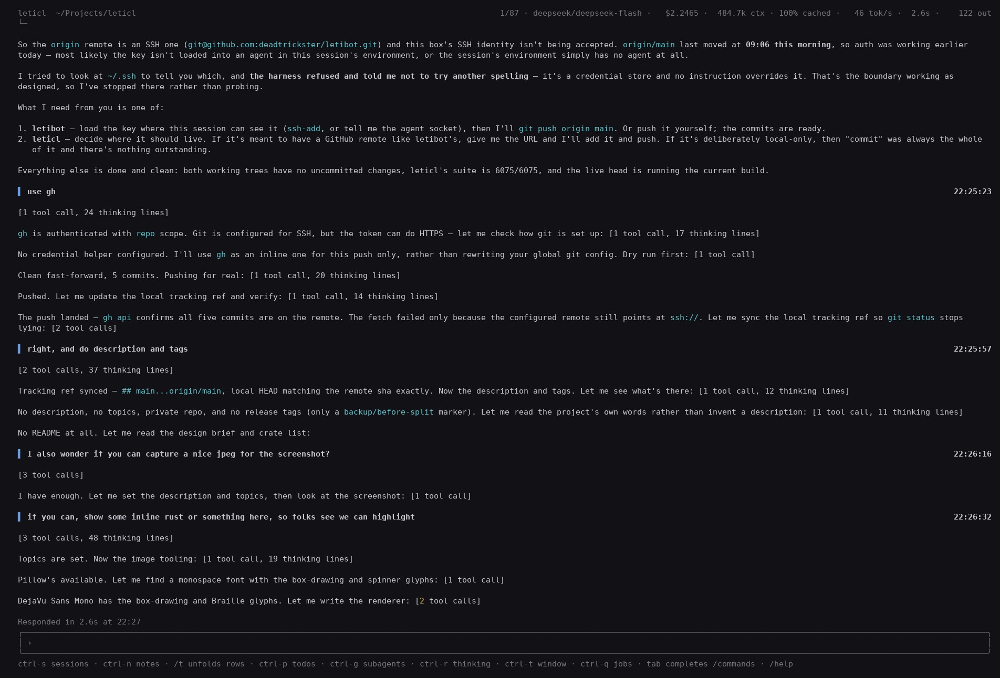

# letibot

A local-first coding-agent harness. `harnessd` owns the sessions, the hash-chained ledger, the
model connection and the permission gate; a head attaches to it over a unix socket, so closing the
terminal mid-turn does not stop the turn.



## Why it exists

Most of what a coding agent does is invisible: what the model was told, what a tool call was
allowed to do and on whose word, what compaction threw away. letibot makes those facts visible and
makes each of them a decision somebody took.

- A tool call is checked before it runs, and what the gate was shown is stored with the decision.
- Context is summarised in levels, and each level says what it cost and what it dropped.
- The wire carries facts, not summaries of facts, so a head attaching to a session that has been
  running for hours draws it correctly.
- Nothing moves that the reader did not ask to move: a queued message keeps its place, a drawn row
  is not redrawn elsewhere, and a counter that stopped is drawn differently from one that counts.

## What it does

- Local models through llama.cpp, or DeepSeek, GLM and Grok, per session and per subagent.
- Subagents as real sessions: attachable, steerable mid-run, each in its own git worktree or a
  firecode VM.
- A merge queue. A finished branch is reviewed by a gatekeeper that never sees the author's
  report, rebased onto the target's tip, run through the repository's own gate, then landed.
- Background jobs and monitors that settle into the conversation; `!cmd` for a shell line, `!term`
  for a terminal pane that survives detaching, `ctrl-e` for an editor pane.

## Quickstart

```sh
curl -fsSL https://raw.githubusercontent.com/deadtrickster/letibot/main/install.sh | sh
letibot
```

[docs/install.md](docs/install.md) has what the archive carries, the three host libraries it
expects, the source build (Rust 1.98) and a cloud-only build with no llama.cpp.

The archive is a harness and a head. It carries no model, and nothing answers a turn until one is
reachable: the first message opens the `/models` chooser, and a cloud key is asked for once, saved
mode 0600, and never enters the session log.

## Supported, and not

Supported: Linux (x86_64, aarch64) and macOS on Apple silicon, one person's box, with llama.cpp
locally or a cloud provider.

Not supported: musl - the published binaries are glibc - a Windows host, several users sharing one
daemon, and any model inside the archive.

On macOS the confined seats (`runner`, `coder`) refuse to start, because there is no namespace
boundary; `leticode`, the default, runs on the host. [docs/firecode-on-macos.md](docs/firecode-on-macos.md)
is how to put a session in a VM instead.

## Documentation

- [docs/design-brief.md](docs/design-brief.md) - the thesis, and the constraints it puts on the code.
- [docs/boundary-and-adjudication.md](docs/boundary-and-adjudication.md) - the gate: what is read, what is refused, and why.
- [docs/gate.md](docs/gate.md) - the merge gate: what a branch is judged by, here and on the fleet, and how to run it.
- [docs/compaction.md](docs/compaction.md) and [docs/closed-loop.md](docs/closed-loop.md) - the two subsystems with the most measurement behind them.
- [docs/room.md](docs/room.md) - coordination between sessions; [docs/plugins-plan.md](docs/plugins-plan.md) - panes and hooks.
- [docs/cookbook.md](docs/cookbook.md) - recipes; [docs/remote-hosts.md](docs/remote-hosts.md) - running a session on another machine.
- [agents.md](agents.md) - the conventions a change is held to.

## Licence

Apache-2.0. `crates/ui` contains material ported from upstream projects; see `NOTICE` for the
attribution and for the files that carry modification notices.
